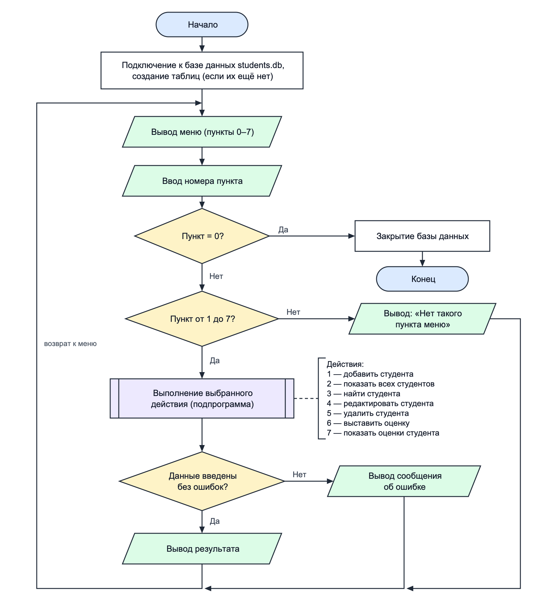
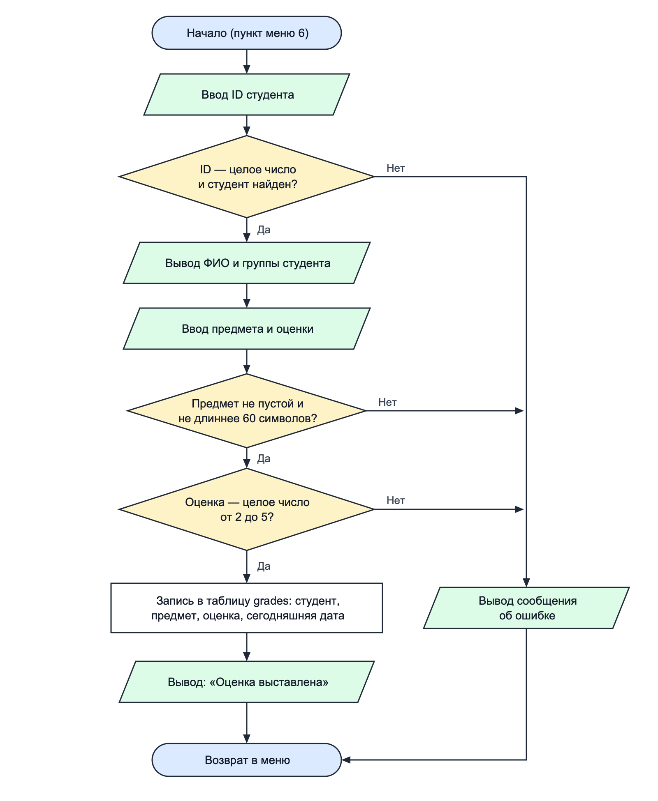
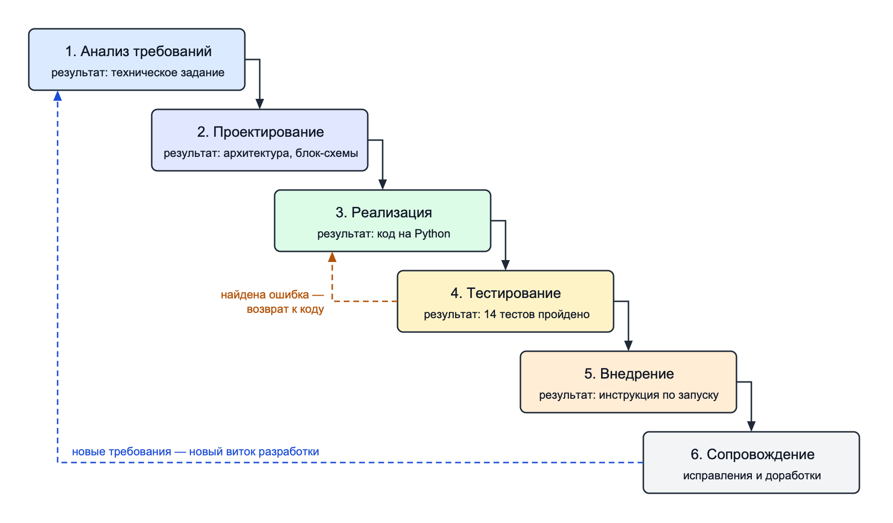
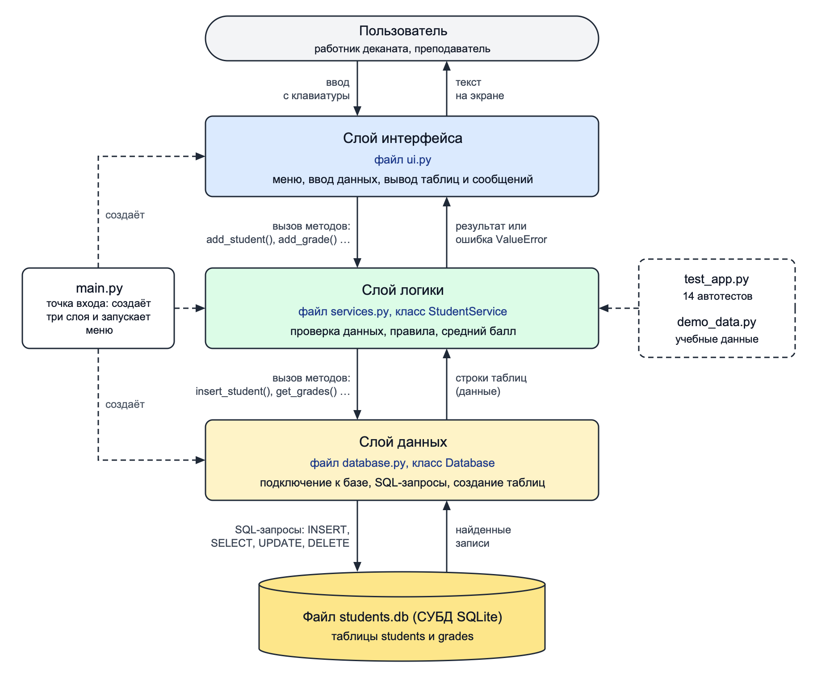

# Практическая работа № 4. Приложение «Учёт студентов»

- **Дисциплина:** Введение в программную инженерию
- **Тема:** Разработка краткого технического задания на создание приложения для учёта студентов

Работа состоит из технического задания и небольшого приложения, написанного по этому ТЗ. Приложение — консольная программа на Python с базой данных SQLite. Она умеет добавлять, показывать, искать, редактировать и удалять студентов, а также выставлять им оценки и считать средний балл.

## Содержание

1. [Техническое задание](#техническое-задание)
2. [Алгоритм: псевдокод и блок-схемы](#алгоритм-псевдокод-и-блок-схемы)
3. [Жизненный цикл ПО](#жизненный-цикл-по)
4. [Архитектура](#архитектура)
5. [Программный код](#программный-код)
6. [Инструкция по запуску](#инструкция-по-запуску)
7. [Примеры проверки](#примеры-проверки)

## Техническое задание

> Структура взята из ГОСТ 19.201-78 «Техническое задание. Требования к содержанию и оформлению» и сокращена под учебную работу. Отдельным файлом: [docs/1_TZ.md](docs/1_TZ.md).

### 1. Введение

**Название программы:** «Учёт студентов».

**Что это:** небольшое консольное приложение (работает в окне терминала, управление — через текстовое меню).

**Где применяется:** в учебном процессе — чтобы вести список студентов и их оценки без бумажного журнала и без Excel.

### 2. Основание для разработки

Задание на практическую работу № 4 по дисциплине «Введение в программную инженерию».

### 3. Назначение разработки

**Функциональное назначение** (что программа делает): хранит список студентов и их оценки, позволяет быстро найти студента и посмотреть его средний балл.

**Эксплуатационное назначение** (кто и как пользуется): один пользователь — преподаватель, староста или работник деканата — на своём компьютере.

### 4. Требования к программе

#### 4.1. Функции программы (функциональные требования)

| Код | Функция | Что должна делать программа | Пункт меню |
|---|---|---|---|
| Ф1 | Добавление студента | Запросить ФИО, группу и номер зачётной книжки, проверить их и сохранить. Номер (ID) студенту присваивается автоматически. | 1 |
| Ф2 | Просмотр списка | Показать таблицу всех студентов: ID, ФИО, группа, № зачётки, средний балл. Сортировка — по группе, затем по ФИО. Под таблицей — количество студентов. | 2 |
| Ф3 | Поиск | Найти студентов по части ФИО, названия группы или номера зачётки. Большие и маленькие буквы не различаются («иван» находит «Иванов»). | 3 |
| Ф4 | Редактирование | По ID студента изменить ФИО, группу или номер зачётки. Если поле оставить пустым (нажать Enter), остаётся прежнее значение. | 4 |
| Ф5 | Удаление | По ID удалить студента. Перед удалением спросить подтверждение. Вместе со студентом удаляются все его оценки. | 5 |
| Ф6 | Выставление оценки | По ID студента записать оценку: предмет и балл от 2 до 5. Дата ставится автоматически (сегодняшняя). | 6 |
| Ф7 | Просмотр оценок | По ID студента показать все его оценки (предмет, оценка, дата) и средний балл. | 7 |
| Ф8 | Выход | Закрыть базу данных и завершить работу. | 0 |

#### 4.2. Входные и выходные данные

**Входные данные** (вводит пользователь с клавиатуры):

| Поле | Тип | Правила проверки |
|---|---|---|
| ФИО | текст | обязательно; не длиннее 100 символов; без цифр |
| Группа | текст | обязательно; не длиннее 20 символов |
| Номер зачётной книжки | текст | обязательно; не длиннее 20 символов; не повторяется у разных студентов |
| ID студента | целое число | студент с таким ID должен быть в базе |
| Предмет | текст | обязательно; не длиннее 60 символов |
| Оценка | целое число | от 2 до 5 |
| Текст для поиска | текст | не пустой |

Лишние пробелы в начале, в конце и между словами программа убирает сама.

**Выходные данные:** таблицы и сообщения на экране («Готово! …» или «Ошибка: …»); файл базы данных `students.db`.

#### 4.3. Требования к надёжности

1. При неправильном вводе программа **не завершается с ошибкой**, а показывает понятное сообщение и возвращается в меню.
2. Каждое изменение сразу сохраняется в файл — после закрытия программы данные не теряются.
3. Удаление студента выполняется только после подтверждения («да»).
4. База данных сама следит за порядком: номер зачётки уникален, оценка только от 2 до 5, оценки удалённого студента удаляются автоматически.

#### 4.4. Условия эксплуатации

Один пользователь, один компьютер, интернет не нужен. От пользователя требуется уметь запустить программу и вводить текст с клавиатуры.

#### 4.5. Требования к техническим средствам

Любой персональный компьютер, на котором работает Python 3. Особых требований к процессору, памяти и диску нет.

#### 4.6. Требования к программной совместимости

| Что | Требование |
|---|---|
| Язык программирования | Python 3.9 или новее (проверено на версиях 3.9, 3.12 и 3.14) |
| База данных | SQLite — через модуль `sqlite3`, который уже входит в Python |
| Сторонние библиотеки | не требуются |
| Операционная система | Windows, macOS или Linux |
| Хранение данных | один файл `students.db` рядом с программой |
| Язык интерфейса | русский |

#### 4.7. Ограничения (что в программу не входит)

- нет графического интерфейса (окон и кнопок) — только текстовое меню;
- нет входа по логину и паролю, нет одновременной работы нескольких пользователей;
- нельзя изменить или удалить отдельную оценку (только вместе со студентом);
- нет печати отчётов и выгрузки в Excel.

Эти возможности можно добавить позже — см. этап «Сопровождение» в файле [3_Lifecycle.md](docs/3_Lifecycle.md).

### 5. Требования к программной документации

Вместе с программой сдаются:

1. техническое задание (этот документ);
2. описание алгоритма — псевдокод и блок-схемы ([2_Algorithm.md](docs/2_Algorithm.md));
3. описание жизненного цикла ([3_Lifecycle.md](docs/3_Lifecycle.md));
4. схема архитектуры и базы данных ([4_Architecture.md](docs/4_Architecture.md));
5. инструкция по запуску ([README.md](#инструкция-по-запуску)) и примеры проверки ([5_Testing.md](docs/5_Testing.md));
6. исходный код с комментариями (папка `src`).

### 6. Стадии и этапы разработки

| № | Этап | Что делается | Результат |
|---|---|---|---|
| 1 | Анализ требований | Определяем, кто пользователь и какие функции ему нужны | Техническое задание |
| 2 | Проектирование | Продумываем части программы, таблицы базы данных, алгоритм | Схема архитектуры, схема БД, блок-схемы |
| 3 | Реализация | Пишем код | Файлы в папке `src` |
| 4 | Тестирование | Проверяем программу автотестами и вручную | Результаты проверки |
| 5 | Внедрение (сдача) | Готовим инструкцию, показываем программу | Инструкция по запуску, защита работы |
| 6 | Гарантийная поддержка | Исправляем ошибки, найденные после сдачи, отвечаем на вопросы пользователя | Исправленные версии программы |

Срок выполнения этапов 1–5 — время, отведённое на практическую работу № 4. Этап 6 длится 1 месяц после приёмки (см. раздел 8).

### 7. Порядок контроля и приёмки

Программа считается принятой, если:

1. она запускается по инструкции из [README.md](#инструкция-по-запуску);
2. работают все функции Ф1–Ф8 из раздела 4.1;
3. контрольные примеры из [5_Testing.md](docs/5_Testing.md) дают ожидаемый результат;
4. все 14 автоматических тестов проходят успешно (`python3 -m unittest -v test_app`).

### 8. Гарантийные обязательства и поддержка

**Гарантийный срок — 1 месяц со дня приёмки программы.**

#### 8.1. Что входит в гарантию

В течение гарантийного срока разработчик бесплатно:

1. исправляет ошибки — случаи, когда программа работает не так, как записано в этом ТЗ;
2. устраняет сбои, из-за которых программа не запускается или завершается аварийно;
3. отвечает на вопросы пользователя по запуску и работе с программой;
4. при необходимости исправляет документацию (инструкцию, описание).

#### 8.2. Сроки

| Что | Срок |
|---|---|
| Гарантийная поддержка | 1 месяц со дня приёмки |
| Ответ на обращение пользователя | не позднее 1 рабочего дня |
| Исправление ошибки | не позднее 3 рабочих дней с момента обращения |

#### 8.3. Как сообщить об ошибке

Пользователь описывает: что он делал (какой пункт меню выбрал и что ввёл), что ожидал получить и что получилось на самом деле. По такому описанию ошибку можно повторить и исправить.

#### 8.4. Что в гарантию не входит

- новые функции, которых нет в разделе 4.1 (например, из списка ограничений 4.7) — они оформляются дополнением к ТЗ;
- ошибки, появившиеся после того, как пользователь сам изменил код программы;
- потеря данных из-за удаления или ручной правки файла `students.db`;
- работа на версиях Python старше 3.9.

#### 8.5. После окончания гарантийного срока

Исправления и доработки выполняются по отдельной договорённости. Это этап «Сопровождение» жизненного цикла программы (см. [3_Lifecycle.md](docs/3_Lifecycle.md)).

## Алгоритм: псевдокод и блок-схемы

### Псевдокод общего алгоритма

```
НАЧАЛО
    подключиться к базе данных students.db
    ЕСЛИ таблиц students и grades ещё нет ТО создать их

    ПОВТОРЯТЬ
        вывести меню
        ввести номер пункта

        ЕСЛИ пункт = 0 ТО
            вывести "До свидания!"
            выйти из цикла
        ИНАЧЕ ЕСЛИ пункт от 1 до 7 ТО
            выполнить выбранное действие
            ЕСЛИ данные введены без ошибок ТО
                вывести результат
            ИНАЧЕ
                вывести "Ошибка: " и объяснение, что не так
        ИНАЧЕ
            вывести "Ошибка: нет такого пункта"
    КОНЕЦ ЦИКЛА

    закрыть базу данных
КОНЕЦ
```

### Блок-схема общего алгоритма



### Блок-схема действия «Выставить оценку»



Обозначения фигур, псевдокод каждого действия и связь схем с кодом — в файле [docs/2_Algorithm.md](docs/2_Algorithm.md).

## Жизненный цикл ПО

### 1. Что такое жизненный цикл ПО

**Жизненный цикл программного обеспечения** — это весь путь программы: от момента, когда появилась идея её создать, до момента, когда ею перестали пользоваться.

Этот путь делят на этапы. Набор процессов жизненного цикла описан в стандарте ГОСТ Р ИСО/МЭК 12207-2010 «Процессы жизненного цикла программных средств».

### 2. Какая модель выбрана и почему

Для этой работы выбрана **каскадная модель** (её ещё называют «водопад»): этапы идут строго по очереди, каждый следующий начинается после завершения предыдущего.

Почему именно она:

- **требования известны заранее и не меняются** — они даны в задании на практическую работу;
- **проект маленький** — около 600 строк кода вместе с комментариями, один разработчик;
- **сразу понятен результат каждого этапа** — документ, схема или код, которые можно показать преподавателю.

Если бы требования часто менялись (например, заказчик каждую неделю просил бы новое), лучше подошла бы гибкая модель (Agile), где программу делают короткими повторяющимися циклами.



*Рисунок 3 — Этапы жизненного цикла (каскадная модель)*

Пунктирные стрелки на рисунке — **обратная связь**. В чистом «водопаде» возвратов нет, но на практике без них не обойтись: если тест нашёл ошибку — возвращаемся к коду; если появились новые требования — начинаем новый виток с анализа.

### 3. Этапы и что на них сделано

| № | Этап | Главный вопрос | Что сделано в этой работе | Результат |
|---|---|---|---|---|
| 1 | Анализ требований | **Что** должна делать программа? | Определён пользователь (преподаватель, деканат), составлен список функций Ф1–Ф8 и правила проверки данных | [Техническое задание](docs/1_TZ.md) |
| 2 | Проектирование | **Как** она будет устроена? | Программа разделена на 3 слоя, придуманы 2 таблицы базы данных, нарисованы алгоритмы | [Архитектура](docs/4_Architecture.md), [блок-схемы](docs/2_Algorithm.md) |
| 3 | Реализация | Написать код | Написаны 4 файла программы на Python с комментариями | Папка `src` |
| 4 | Тестирование | Работает ли она **правильно**? | Написано и пройдено 14 автотестов, вручную выполнено 12 контрольных примеров | [Результаты проверки](docs/5_Testing.md) |
| 5 | Внедрение | Передать пользователю | Написана инструкция по запуску, подготовлены учебные данные для показа | [README.md](#инструкция-по-запуску), `demo_data.py` |
| 6 | Сопровождение | Исправлять и улучшать | Этап начинается после сдачи работы. Первый месяц — гарантийная поддержка по разделу 8 ТЗ; намечены возможные доработки (см. ниже) | Новые версии программы |

#### Этап 1. Анализ требований

Сначала нужно понять задачу, а не писать код. На этом этапе получены ответы на вопросы:

- *Кто пользователь?* — один человек: преподаватель, староста или работник деканата.
- *Что ему нужно?* — вести список студентов, ставить оценки, быстро находить нужного студента.
- *Какие данные хранить?* — ФИО, группа, номер зачётки; по оценке — предмет, балл, дата.
- *Что считать ошибкой ввода?* — пустое ФИО, повтор номера зачётки, оценка не от 2 до 5 и т. д.

Все ответы записаны в техническое задание. ТЗ — главный документ: по нему потом и проектируют, и проверяют программу.

#### Этап 2. Проектирование

Принятые решения:

- **Три слоя**: интерфейс (`ui.py`), логика (`services.py`), данные (`database.py`). Каждый слой делает только свою работу.
- **Две таблицы**: `students` и `grades` со связью «один ко многим».
- **SQLite** в качестве базы данных — не нужен отдельный сервер, вся база лежит в одном файле.
- **Поиск без учёта регистра.** Встроенная функция SQLite `LOWER()` не умеет переводить русские буквы в маленькие, поэтому решено подключить к базе собственную функцию `py_lower`, написанную на Python.

#### Этап 3. Реализация

Код писался «снизу вверх»: сначала слой данных, потом логика, потом интерфейс. Так каждый новый слой опирается на уже готовый.

#### Этап 4. Тестирование

Два вида проверки:

- **автоматические тесты** (`test_app.py`) — программа сама проверяет функции: 14 тестов, все пройдены;
- **ручная проверка** — 12 контрольных примеров через меню, как это делал бы пользователь.

Проверялись не только правильные данные, но и ошибочные: пустое ФИО, оценка 7, несуществующий ID.

#### Этап 5. Внедрение

Для такой программы внедрение простое: скопировать папку на компьютер и запустить `main.py`. Установка не нужна, база данных создаётся автоматически при первом запуске.

#### Этап 6. Сопровождение

Первый месяц после сдачи — **гарантийный срок** (раздел 8 ТЗ). Если пользователь находит ошибку, разработчик бесплатно исправляет её не позднее чем за 3 рабочих дня. Новые функции в гарантию не входят: для них сначала дополняют ТЗ.

После сдачи программу можно и развивать. Что можно добавить:

- изменение и удаление отдельной оценки;
- графический интерфейс (окна и кнопки);
- отчёт по группе (средний балл группы, список должников);
- выгрузку списка в файл Excel или CSV.

Благодаря трём слоям такие доработки делать легко: например, графический интерфейс заменит только файл `ui.py`, а логика и база данных останутся прежними.

### 4. Какое место в жизненном цикле занимает ТЗ

Техническое задание появляется на первом этапе, но используется на всех остальных:

| Этап | Как используется ТЗ |
|---|---|
| Анализ требований | ТЗ составляется и согласуется с заказчиком (здесь — с преподавателем) |
| Проектирование | архитектура и база данных строятся так, чтобы выполнить требования из ТЗ |
| Реализация | программист пишет ровно те функции, которые перечислены в ТЗ, — не больше и не меньше |
| Тестирование | каждый пункт ТЗ превращается в проверку: «в ТЗ написано так — а программа делает так?» |
| Внедрение (приёмка) | заказчик принимает программу по разделу ТЗ «Порядок контроля и приёмки» |
| Сопровождение | в гарантийный срок (1 месяц, раздел 8 ТЗ) ошибкой считается то, что расходится с ТЗ; если нужны новые функции, сначала дополняют ТЗ, потом меняют программу |

Вывод: **ТЗ — это «договор» между заказчиком и разработчиком.** Без него нельзя доказать, что программа готова, потому что непонятно, с чем её сравнивать.

## Архитектура

Программа разделена на три слоя. Каждый слой делает только свою работу и обращается только к соседнему слою ниже.



Подробное описание слоёв, пример прохождения запроса и схема базы данных — в файле [docs/4_Architecture.md](docs/4_Architecture.md).

## Программный код

Код с комментариями лежит в папке [src](src).

```
├── README.md               эта страница
├── src/                    исходный код
│   ├── main.py             точка входа — запускать этот файл
│   ├── ui.py               слой интерфейса: меню, ввод и вывод
│   ├── services.py         слой логики: проверки и правила
│   ├── database.py         слой данных: работа с SQLite
│   ├── demo_data.py        заполнение базы учебными данными
│   └── test_app.py         автоматические тесты (14 штук)
└── docs/                   документация отдельными файлами
    ├── 1_TZ.md             техническое задание
    ├── 2_Algorithm.md      псевдокод и блок-схемы
    ├── 3_Lifecycle.md      жизненный цикл ПО
    ├── 4_Architecture.md   архитектура и схема базы данных
    ├── 5_Testing.md        примеры проверки, соответствие ТЗ и кода
    └── images/             схемы: PNG и SVG
```

## Инструкция по запуску

### Что нужно

Только Python версии 3.9 или новее. Ничего дополнительно устанавливать не надо: SQLite уже входит в Python.

Проверить, что Python установлен:

```bash
python3 --version
```

Если команда не найдена, установите Python с сайта python.org.

> **Windows:** во всех командах ниже пишите `python` вместо `python3`.

### Шаг 1. Открыть терминал в папке с кодом

```bash
cd src
```

### Шаг 2 (по желанию). Заполнить базу учебными данными

```bash
python3 demo_data.py
```

Добавятся 5 выдуманных студентов и 7 оценок, чтобы было что показывать. Повторный запуск ничего не испортит: если студенты в базе уже есть, скрипт ничего не добавит.

### Шаг 3. Запустить программу

```bash
python3 main.py
```

Появится меню:

```
========== УЧЁТ СТУДЕНТОВ ==========
 1. Добавить студента
 2. Показать всех студентов
 3. Найти студента
 4. Редактировать студента
 5. Удалить студента
 6. Выставить оценку
 7. Показать оценки студента
 0. Выход
=====================================
Выберите пункт меню:
```

Введите номер пункта и нажмите Enter. Дальше программа сама подскажет, что вводить.

### Шаг 4. Запустить автоматические тесты

```bash
python3 -m unittest -v test_app
```

В конце должно быть написано `Ran 14 tests` и `OK`.

### Полезно знать

- **Где хранятся данные.** В файле `src/students.db`. Он создаётся сам при первом запуске.
- **Как начать с чистого листа.** Закройте программу и удалите файл `src/students.db`.
- **ID студента.** Для редактирования, удаления и оценок нужен ID. Его видно в первом столбце списка (пункт 2) и в результатах поиска (пункт 3).
- **Оценки.** Принимаются целые числа от 2 до 5.

## Примеры проверки

1. Пункт `1` — добавить студента: `Назаров Тимур Олегович`, `ПИ-101`, `2024-010`. Программа ответит «Готово! Студент добавлен» и покажет его ID.
2. Пункт `6` — поставить ему оценку: ввести его ID, предмет `Математика`, оценку `5`.
3. Пункт `6` ещё раз, но с оценкой `7` — программа ответит «Ошибка: Оценка должна быть от 2 до 5.» и вернётся в меню.
4. Пункт `3` — найти его по тексту `назаров` маленькими буквами.
5. Пункт `0` — выйти. Запустить программу снова и выбрать `2` — студент и оценка на месте.

Полный список из 12 контрольных примеров, результаты 14 автотестов и таблица соответствия ТЗ и кода — в файле [docs/5_Testing.md](docs/5_Testing.md).

Программа и тесты запускались на macOS с Python 3.9, 3.12 и 3.14. На Windows запуск не проверялся, но в коде нет ничего, что зависит от операционной системы.
