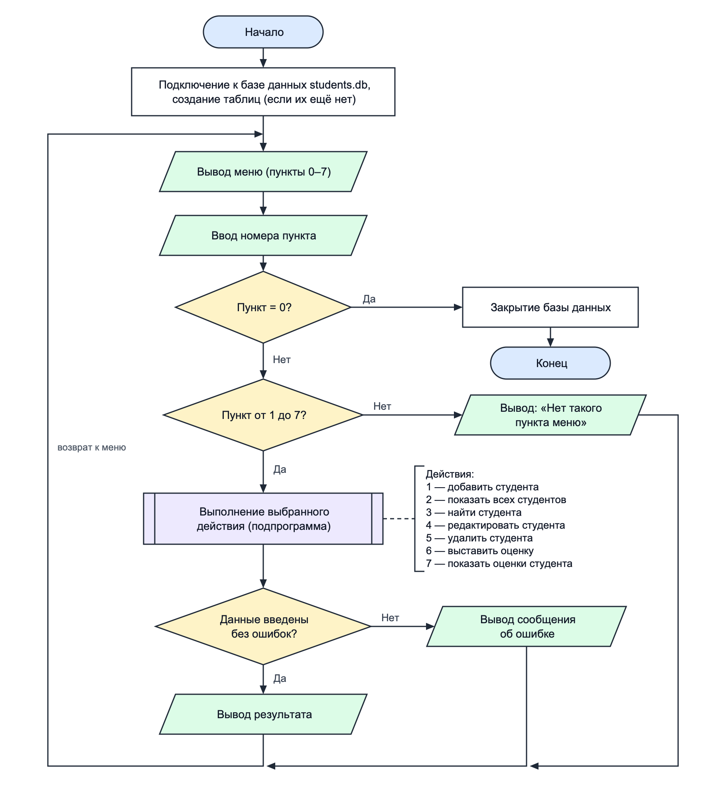
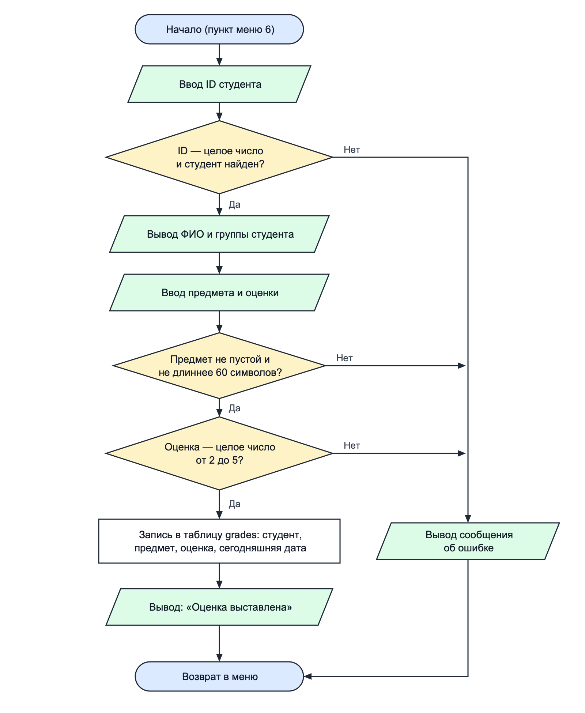

# Алгоритм работы программы: псевдокод и блок-схемы

Здесь один и тот же алгоритм показан двумя способами:

- **псевдокод** — алгоритм, записанный обычными словами по шагам;
- **блок-схема** — тот же алгоритм в виде рисунка.

## 1. Обозначения на блок-схемах

Фигуры взяты из ГОСТ 19.701-90 «Схемы алгоритмов, программ, данных и систем».

| Фигура | Что означает |
|---|---|
| Овал (скруглённый прямоугольник) | начало или конец алгоритма |
| Прямоугольник | действие (что-то вычислить, записать) |
| Параллелограмм | ввод данных с клавиатуры или вывод на экран |
| Ромб | условие (вопрос с ответом «да» или «нет») |
| Прямоугольник с двойными боковыми линиями | подпрограмма — отдельный алгоритм, описанный в другом месте |
| Пунктир со скобкой | комментарий (пояснение к блоку) |

## 2. Общий алгоритм программы

### Псевдокод

```
НАЧАЛО
    подключиться к базе данных students.db
    ЕСЛИ таблиц students и grades ещё нет ТО создать их

    ПОВТОРЯТЬ
        вывести меню
        ввести номер пункта

        ЕСЛИ пункт = 0 ТО
            вывести "До свидания!"
            выйти из цикла
        ИНАЧЕ ЕСЛИ пункт от 1 до 7 ТО
            выполнить выбранное действие
            ЕСЛИ данные введены без ошибок ТО
                вывести результат
            ИНАЧЕ
                вывести "Ошибка: " и объяснение, что не так
        ИНАЧЕ
            вывести "Ошибка: нет такого пункта"
    КОНЕЦ ЦИКЛА

    закрыть базу данных
КОНЕЦ
```

### Блок-схема



*Рисунок 1 — Общая блок-схема работы программы*

### Где это в коде

| Блок на схеме | Где в коде |
|---|---|
| Подключение к базе, создание таблиц | `main.py` — строка `db = Database()`; сами таблицы — `create_tables()` в `database.py` |
| Вывод меню, ввод пункта | `ui.py`, функция `run()` — `print(MENU)` и `input(...)` |
| Пункт = 0? | `ui.py`, `run()` — `if choice == "0": ... break` |
| Пункт от 1 до 7? | `ui.py`, `run()` — поиск в словаре `ACTIONS.get(choice)` |
| Выполнение действия | `ui.py`, `run()` — `action(service)`; действия — функции `action_...` |
| Данные без ошибок? | `ui.py`, `run()` — блок `try ... except ValueError` |
| Закрытие базы данных | `main.py` — `db.close()` в блоке `finally` |

## 3. Алгоритм действия «Выставить оценку» (подробно)

Это самое показательное действие: в нём три проверки подряд.

### Псевдокод

```
НАЧАЛО
    ввести ID студента
    ЕСЛИ ID не целое число ИЛИ студента с таким ID нет ТО
        вывести сообщение об ошибке, вернуться в меню

    вывести ФИО и группу найденного студента
    ввести предмет и оценку

    ЕСЛИ название предмета пустое ИЛИ длиннее 60 символов ТО
        вывести сообщение об ошибке, вернуться в меню
    ЕСЛИ оценка не целое число ИЛИ оценка меньше 2 ИЛИ больше 5 ТО
        вывести сообщение об ошибке, вернуться в меню

    записать в таблицу grades: студента, предмет, оценку, сегодняшнюю дату
    вывести "Готово! Оценка выставлена."
КОНЕЦ (возврат в меню)
```

### Блок-схема



*Рисунок 2 — Блок-схема действия «Выставить оценку»*

В коде: ввод и вывод — функция `action_add_grade()` в `ui.py`; проверки — метод `add_grade()` в `services.py`; запись в базу — метод `insert_grade()` в `database.py`.

## 4. Псевдокод остальных действий

### Добавить студента (пункт 1)

```
ввести ФИО, группу, номер зачётки
убрать лишние пробелы
ЕСЛИ ФИО пустое ИЛИ длиннее 100 символов ИЛИ содержит цифры ТО ошибка
ЕСЛИ группа пустая ИЛИ длиннее 20 символов ТО ошибка
ЕСЛИ номер зачётки пустой ИЛИ длиннее 20 символов ТО ошибка
ЕСЛИ такой номер зачётки уже есть у другого студента ТО ошибка
записать студента в таблицу students
вывести "Готово! Студент добавлен" и его ID
```

### Показать всех студентов (пункт 2)

```
получить из базы всех студентов и средний балл каждого (сортировка: группа, ФИО)
ЕСЛИ список пуст ТО
    вывести "Список пуст."
ИНАЧЕ
    вывести таблицу и количество студентов
```

### Найти студента (пункт 3)

```
ввести текст для поиска
ЕСЛИ текст пустой ТО ошибка
перевести текст в маленькие буквы
выбрать студентов, у которых ФИО, группа или номер зачётки содержат этот текст
ЕСЛИ никого не нашли ТО вывести "Ничего не найдено."
ИНАЧЕ вывести таблицу найденных
```

### Редактировать студента (пункт 4)

```
ввести ID студента
ЕСЛИ ID не число ИЛИ такого студента нет ТО ошибка
ДЛЯ каждого поля (ФИО, группа, номер зачётки):
    показать старое значение и ввести новое
    ЕСЛИ ничего не ввели (нажали Enter) ТО оставить старое значение
проверить поля так же, как при добавлении
    (свой собственный номер зачётки "занятым" не считается)
обновить запись в таблице students
вывести "Готово! Данные студента обновлены."
```

### Удалить студента (пункт 5)

```
ввести ID студента
ЕСЛИ ID не число ИЛИ такого студента нет ТО ошибка
спросить: "Удалить студента ... и все его оценки? (да/нет)"
ЕСЛИ ответ "да" ТО
    удалить студента из таблицы students (его оценки база удалит сама)
    вывести "Готово! Студент удалён."
ИНАЧЕ
    вывести "Удаление отменено."
```

### Показать оценки студента (пункт 7)

```
ввести ID студента
ЕСЛИ ID не число ИЛИ такого студента нет ТО ошибка
получить из базы все оценки этого студента
ЕСЛИ оценок нет ТО
    вывести "Оценок пока нет."
ИНАЧЕ
    вывести таблицу: предмет, оценка, дата
    средний балл = сумма оценок / количество оценок (округлить до сотых)
    вывести средний балл
```
