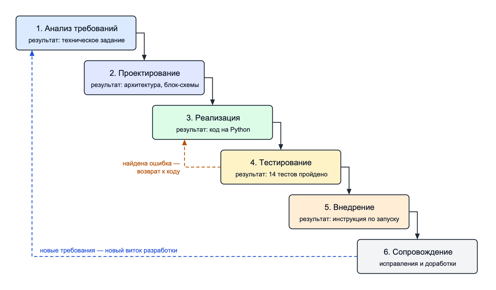

# Жизненный цикл программы «Учёт студентов»

## 1. Что такое жизненный цикл ПО

**Жизненный цикл программного обеспечения** — это весь путь программы: от момента, когда появилась идея её создать, до момента, когда ею перестали пользоваться.

Этот путь делят на этапы. Набор процессов жизненного цикла описан в стандарте ГОСТ Р ИСО/МЭК 12207-2010 «Процессы жизненного цикла программных средств».

## 2. Какая модель выбрана и почему

Для этой работы выбрана **каскадная модель** (её ещё называют «водопад»): этапы идут строго по очереди, каждый следующий начинается после завершения предыдущего.

Почему именно она:

- **требования известны заранее и не меняются** — они даны в задании на практическую работу;
- **проект маленький** — около 600 строк кода вместе с комментариями, один разработчик;
- **сразу понятен результат каждого этапа** — документ, схема или код, которые можно показать преподавателю.

Если бы требования часто менялись (например, заказчик каждую неделю просил бы новое), лучше подошла бы гибкая модель (Agile), где программу делают короткими повторяющимися циклами.

*Рисунок 3 — Этапы жизненного цикла (каскадная модель)*

Пунктирные стрелки на рисунке — **обратная связь**. В чистом «водопаде» возвратов нет, но на практике без них не обойтись: если тест нашёл ошибку — возвращаемся к коду; если появились новые требования — начинаем новый виток с анализа.

## 3. Этапы и что на них сделано

| № | Этап | Главный вопрос | Что сделано в этой работе | Результат |
|---|---|---|---|---|
| 1 | Анализ требований | **Что** должна делать программа? | Определён пользователь (преподаватель, деканат), составлен список функций Ф1–Ф8 и правила проверки данных | [Техническое задание](1_TZ.md) |
| 2 | Проектирование | **Как** она будет устроена? | Программа разделена на 3 слоя, придуманы 2 таблицы базы данных, нарисованы алгоритмы | [Архитектура](4_Architecture.md), [блок-схемы](2_Algorithm.md) |
| 3 | Реализация | Написать код | Написаны 4 файла программы на Python с комментариями | Папка `src` |
| 4 | Тестирование | Работает ли она **правильно**? | Написано и пройдено 14 автотестов, вручную выполнено 12 контрольных примеров | [Результаты проверки](5_Testing.md) |
| 5 | Внедрение | Передать пользователю | Написана инструкция по запуску, подготовлены учебные данные для показа | [README.md](../README.md), `demo_data.py` |
| 6 | Сопровождение | Исправлять и улучшать | Этап начинается после сдачи работы. Первый месяц — гарантийная поддержка по разделу 8 ТЗ; намечены возможные доработки (см. ниже) | Новые версии программы |

### Этап 1. Анализ требований

Сначала нужно понять задачу, а не писать код. На этом этапе получены ответы на вопросы:

- *Кто пользователь?* — один человек: преподаватель, староста или работник деканата.
- *Что ему нужно?* — вести список студентов, ставить оценки, быстро находить нужного студента.
- *Какие данные хранить?* — ФИО, группа, номер зачётки; по оценке — предмет, балл, дата.
- *Что считать ошибкой ввода?* — пустое ФИО, повтор номера зачётки, оценка не от 2 до 5 и т. д.

Все ответы записаны в техническое задание. ТЗ — главный документ: по нему потом и проектируют, и проверяют программу.

### Этап 2. Проектирование

Принятые решения:

- **Три слоя**: интерфейс (`ui.py`), логика (`services.py`), данные (`database.py`). Каждый слой делает только свою работу.
- **Две таблицы**: `students` и `grades` со связью «один ко многим».
- **SQLite** в качестве базы данных — не нужен отдельный сервер, вся база лежит в одном файле.
- **Поиск без учёта регистра.** Встроенная функция SQLite `LOWER()` не умеет переводить русские буквы в маленькие, поэтому решено подключить к базе собственную функцию `py_lower`, написанную на Python.

### Этап 3. Реализация

Код писался «снизу вверх»: сначала слой данных, потом логика, потом интерфейс. Так каждый новый слой опирается на уже готовый.

### Этап 4. Тестирование

Два вида проверки:

- **автоматические тесты** (`test_app.py`) — программа сама проверяет функции: 14 тестов, все пройдены;
- **ручная проверка** — 12 контрольных примеров через меню, как это делал бы пользователь.

Проверялись не только правильные данные, но и ошибочные: пустое ФИО, оценка 7, несуществующий ID.

### Этап 5. Внедрение

Для такой программы внедрение простое: скопировать папку на компьютер и запустить `main.py`. Установка не нужна, база данных создаётся автоматически при первом запуске.

### Этап 6. Сопровождение

Первый месяц после сдачи — **гарантийный срок** (раздел 8 ТЗ). Если пользователь находит ошибку, разработчик бесплатно исправляет её не позднее чем за 3 рабочих дня. Новые функции в гарантию не входят: для них сначала дополняют ТЗ.

После сдачи программу можно и развивать. Что можно добавить:

- изменение и удаление отдельной оценки;
- графический интерфейс (окна и кнопки);
- отчёт по группе (средний балл группы, список должников);
- выгрузку списка в файл Excel или CSV.

Благодаря трём слоям такие доработки делать легко: например, графический интерфейс заменит только файл `ui.py`, а логика и база данных останутся прежними.

## 4. Какое место в жизненном цикле занимает ТЗ

Техническое задание появляется на первом этапе, но используется на всех остальных:

| Этап | Как используется ТЗ |
|---|---|
| Анализ требований | ТЗ составляется и согласуется с заказчиком (здесь — с преподавателем) |
| Проектирование | архитектура и база данных строятся так, чтобы выполнить требования из ТЗ |
| Реализация | программист пишет ровно те функции, которые перечислены в ТЗ, — не больше и не меньше |
| Тестирование | каждый пункт ТЗ превращается в проверку: «в ТЗ написано так — а программа делает так?» |
| Внедрение (приёмка) | заказчик принимает программу по разделу ТЗ «Порядок контроля и приёмки» |
| Сопровождение | в гарантийный срок (1 месяц, раздел 8 ТЗ) ошибкой считается то, что расходится с ТЗ; если нужны новые функции, сначала дополняют ТЗ, потом меняют программу |

Вывод: **ТЗ — это «договор» между заказчиком и разработчиком.** Без него нельзя доказать, что программа готова, потому что непонятно, с чем её сравнивать.
