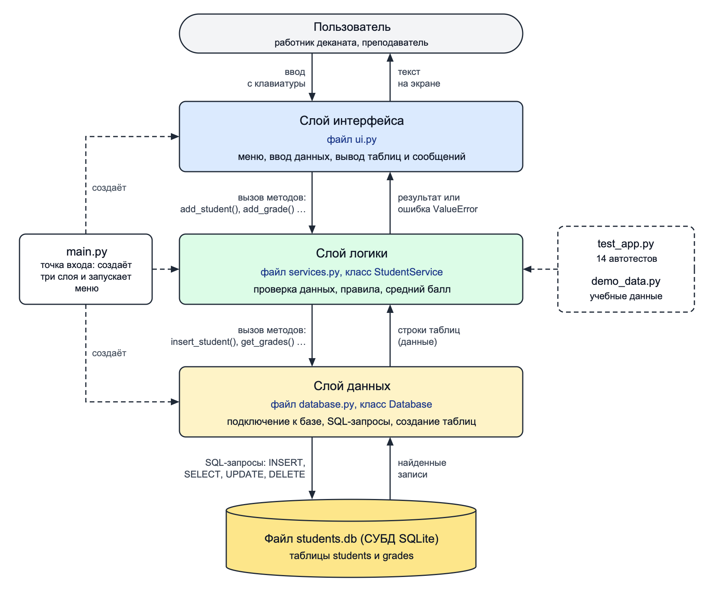
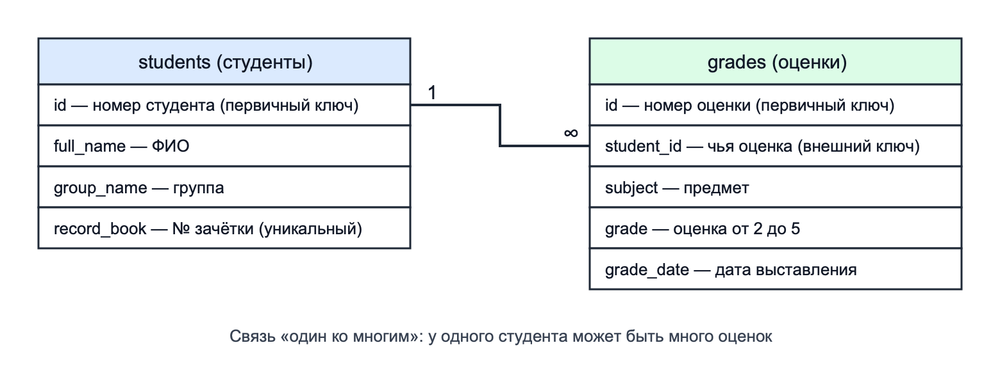

# Архитектура приложения «Учёт студентов»

## 1. Что такое архитектура

**Архитектура программы** — это то, из каких частей она состоит и как эти части общаются между собой.

В этой программе использована **трёхслойная архитектура**. Программа похожа на деканат, где у каждого своя работа:

- **окошко приёма** — принимает просьбы и выдаёт ответы (слой интерфейса);
- **секретарь** — проверяет, правильно ли заполнены бумаги (слой логики);
- **архив** — хранит документы (слой данных).

## 2. Схема архитектуры

*Рисунок 4 — Архитектура приложения и взаимодействие компонентов*

Сплошные стрелки — обмен данными во время работы. Пунктирные — «кто кого создаёт или использует».

## 3. Компоненты

| Компонент | Файл | Что делает | Чего НЕ делает |
|---|---|---|---|
| Точка входа | `main.py` | Создаёт базу данных, логику и интерфейс, соединяет их и запускает меню | Не содержит ни правил, ни SQL |
| Слой интерфейса | `ui.py` | Показывает меню, спрашивает данные (`input`), печатает таблицы и сообщения (`print`) | Не проверяет данные и не знает про базу |
| Слой логики | `services.py`, класс `StudentService` | Проверяет данные по правилам из ТЗ, считает средний балл, ставит дату оценки | Ничего не печатает и не пишет SQL |
| Слой данных | `database.py`, класс `Database` | Подключается к SQLite, создаёт таблицы, выполняет SQL-запросы | Не проверяет правила и ничего не печатает |
| Хранилище | файл `students.db` | Хранит таблицы `students` и `grades` | — |
| Автотесты | `test_app.py` | Проверяют слой логики и слой данных без участия человека | В работе программы не участвуют |
| Учебные данные | `demo_data.py` | Добавляет в пустую базу 5 студентов и 7 оценок для показа | В работе программы не участвует |

## 4. Правила взаимодействия

1. **Каждый слой обращается только к соседнему слою ниже.** Интерфейс → логика → данные → файл базы. Интерфейс никогда не обращается к базе напрямую.
2. **Вниз идут просьбы, вверх — ответы.** Интерфейс вызывает метод логики (например, `add_grade`), логика вызывает метод слоя данных (`insert_grade`), тот выполняет SQL-запрос.
3. **Об ошибках сообщает слой логики.** Если данные неверные, он создаёт ошибку `ValueError` с понятным текстом. Интерфейс её ловит и показывает пользователю. До базы неверные данные не доходят.

## 5. Пример: что происходит при выставлении оценки

Пользователь выбрал пункт 6 и ввёл: ID = 1, предмет «Математика», оценка 5.

| Шаг | Кто работает | Что происходит |
|---|---|---|
| 1 | Интерфейс (`ui.py`) | Функция `action_add_grade` спрашивает ID и передаёт его в логику: `service.get_student("1")` |
| 2 | Логика (`services.py`) | Превращает текст `"1"` в число и просит слой данных найти студента: `db.get_student(1)` |
| 3 | Данные (`database.py`) | Выполняет запрос `SELECT ... WHERE s.id = 1` и возвращает строку со студентом |
| 4 | Интерфейс | Печатает ФИО студента, спрашивает предмет и оценку, вызывает `service.add_grade(1, "Математика", "5")` |
| 5 | Логика | Проверяет: предмет не пустой, оценка — число от 2 до 5. Берёт сегодняшнюю дату. Вызывает `db.insert_grade(...)` |
| 6 | Данные | Выполняет `INSERT INTO grades ...` и сохраняет изменения (`commit`) |
| 7 | Интерфейс | Печатает «Готово! Оценка выставлена.» |

**Если ввести оценку 7:** на шаге 5 логика создаёт ошибку «Оценка должна быть от 2 до 5». Шаг 6 не выполняется — в базу ничего не пишется. Интерфейс печатает «Ошибка: Оценка должна быть от 2 до 5.» и возвращается в меню.

## 6. Схема базы данных

*Рисунок 5 — Таблицы базы данных и связь между ними*

**Таблица `students` (студенты)**

| Поле | Тип | Описание |
|---|---|---|
| `id` | целое число | номер студента; первичный ключ, база выдаёт его сама |
| `full_name` | текст | ФИО; обязательное |
| `group_name` | текст | группа; обязательное |
| `record_book` | текст | номер зачётной книжки; обязательное, уникальное |

**Таблица `grades` (оценки)**

| Поле | Тип | Описание |
|---|---|---|
| `id` | целое число | номер оценки; первичный ключ |
| `student_id` | целое число | ID студента, которому поставлена оценка; внешний ключ на `students.id` |
| `subject` | текст | предмет |
| `grade` | целое число | оценка; база принимает только значения от 2 до 5 |
| `grade_date` | текст | дата в виде `2026-11-24` |

Пояснения к терминам:

- **Первичный ключ** — поле, по которому каждую строку можно отличить от других (как номер паспорта).
- **Внешний ключ** — поле, которое ссылается на строку в другой таблице. Здесь `student_id` говорит, чья это оценка.
- **Связь «один ко многим»** — у одного студента может быть много оценок, но каждая оценка принадлежит только одному студенту.
- **Каскадное удаление** (`ON DELETE CASCADE`) — при удалении студента база сама удаляет все его оценки, чтобы не оставалось «ничьих» записей.

Средний балл в таблицах **не хранится** — он каждый раз считается заново по оценкам. Так он не может «разойтись» с настоящими оценками.

## 7. Почему выбрана такая архитектура

| Преимущество | Пример |
|---|---|
| Легко найти нужное место в коде | Неправильное сообщение на экране — смотрим `ui.py`. Неверная проверка — `services.py`. Ошибка в запросе — `database.py` |
| Можно заменить один слой, не трогая другие | Чтобы сделать окна и кнопки вместо консоли, нужно переписать только `ui.py` |
| Логику можно проверять автоматически | Тесты вызывают `StudentService` напрямую, без меню и клавиатуры |
| Правила собраны в одном месте | Чтобы поменять шкалу оценок, достаточно изменить `MIN_GRADE` и `MAX_GRADE` в `services.py` и условие `CHECK` в `database.py` |
